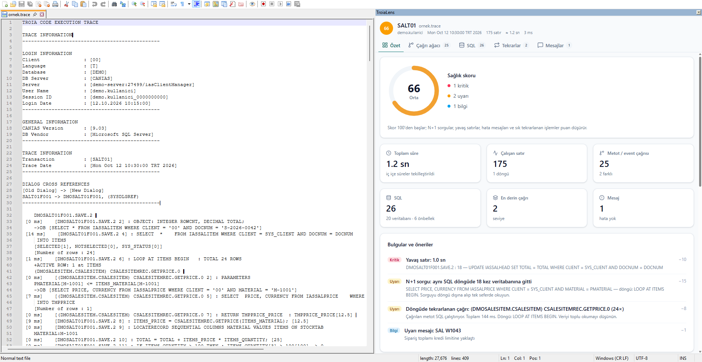
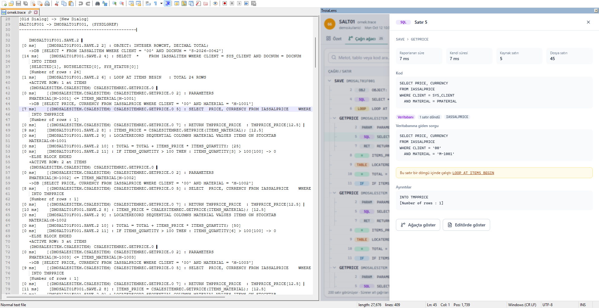
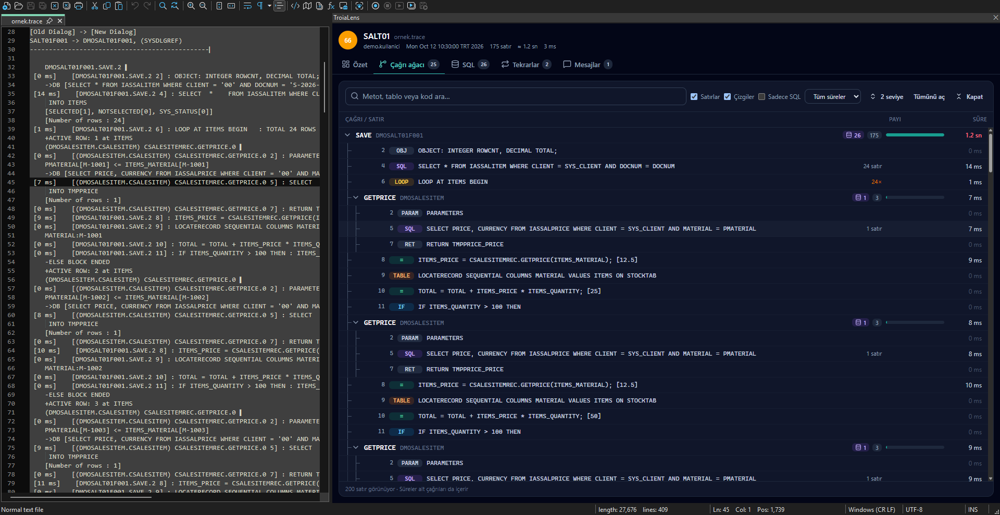
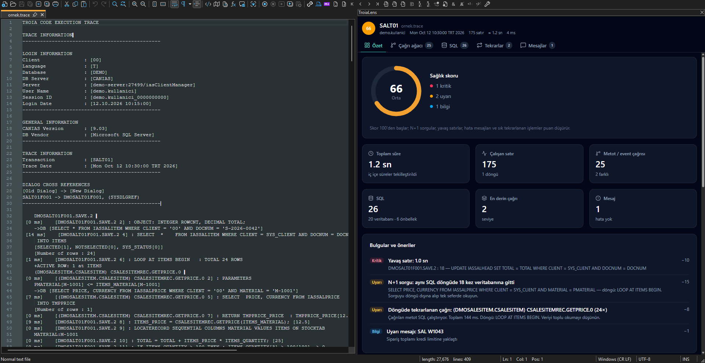

# TroiaLens — Notepad++ eklentisi


Canias ERP'nin **TROIA CODE EXECUTION TRACE** dosyalarını Notepad++ içinde analiz eden bir eklenti.
Trace dosyasını açtığınızda sağ tarafta bir panel açılır. Panelde şu sekmeler vardır: Özet, Çağrı ağacı, SQL,
Tekrarlar, Mesajlar ve Hata/Uyarı. Paneldeki bir satıra tıkladığınızda editör o satıra gider.

Paneldeki ekranlar [TroiaLens web uygulamasıyla](https://github.com/ufukt51/TroiaLens) aynıdır.

## Ekran görüntüleri

Görüntülerdeki veriler örnektir, gerçek değildir.



| | |
|---|---|
|  |  |
| Seçilen satırın ayrıntısı altta açılır; editör aynı satıra gider ve metodu sarıyla işaretler. | Koyu tema. Çift tıklanan kelime editörde pembeyle işaretlenir. |
|  | |
| Koyu tema, özet | |

## Nasıl çalışır?

- Bir trace dosyasına geçtiğinizde panel kendiliğinden açılır ve analiz başlar. Uzantı `.trace` ya da `.txt`
  olabilir; `.txt` dosyalarında içeriğe bakılır, sıradan metin dosyalarında panel açılmaz.
- Trace olmayan bir dosyaya geçince panel gizlenir. Paneli menüden kendiniz açtıysanız açık kalır ve
  "Bu bir Troia trace dosyası değil" uyarısı görünür.
- Paneldeki bir satıra tıkladığınızda editör o satıra gider. Editörde imleci başka bir satıra taşıdığınızda da
  panel o satırı seçer.
- Ayrıntı başlığındaki **Editörde göster** düğmesi satıra gider ve imleci editöre taşır.
- Çağrı ağacında bir satır seçtiğinizde, satırın ait olduğu metot editörde açık sarıyla, satırın kendisi koyu sarıyla
  işaretlenir.
- Editörde bir kelimeye çift tıkladığınızda, kelime dosyada geçtiği her yerde pembeyle işaretlenir. Aynı kelimeye
  yeniden çift tıklarsanız işaret kalkar.
- Satır ayrıntısı alt bölmede açılır. Ayrıntı başlığındaki düğmeyle ya da menüden sağdan kayan panele geçebilirsiniz;
  tercihiniz hatırlanır.
- Trace dosyalarının metni editörde renklenir: deyimler, SQL, metot adları, değerler ve süreler ayrı renklerle,
  hata satırları kırmızı zeminle, uyarılar dalgalı alt çizgiyle gösterilir. Panel kapalıyken de çalışır; menüden
  kapatabilirsiniz.
- Dosyayı kaydettiğinizde analiz yenilenir.
- Notepad++ koyu temadaysa panel de koyu açılır.
- Bir trace dosyasında paneli kapatırsanız, Notepad++'ı kapatana kadar o dosyada panel kendiliğinden açılmaz.
  Menüden yeniden açabilirsiniz.
- Notepad++'ı panel açıkken kapatırsanız, bir sonraki açılışta panel yine açık gelir.

## Menü

**Eklentiler > TroiaLens**

| Komut | Ne yapar? |
|---|---|
| TroiaLens paneli | Paneli açar veya kapatır |
| Aktif dosyayı analiz et | Paneli açar ve açık dosyayı yeniden analiz eder. Uzantısı farklı olsa da içeriği trace ise çalışır. |
| Trace dosyalarında paneli otomatik aç | Trace dosyasına geçince panelin kendiliğinden açılıp açılmayacağını belirler |
| Sekme değişince yeniden analiz et | Panel açıkken her sekme değişiminde analizi yeniler |
| Satır ayrıntısını sağda kayan panelde aç | Satır ayrıntısını alt bölme yerine sağdan kayan panelde gösterir |
| Sözdizimi renkleri | Trace dosyalarının metnini editörde renklendirir; kapatınca renkler kalkar |
| Hakkında | Sürümü, trace uzantılarını ve ayar dosyasının yerini gösterir |

## Ayarlar

Ayarlar Notepad++'ın ayar klasöründeki `plugins\config\TroiaLens.ini` dosyasında saklanır. Tam yolu menüdeki
**Hakkında** penceresinde görebilirsiniz. Çoğu ayarı menüden değiştirebilirsiniz. Dosyayı elle düzenleyecekseniz
önce Notepad++'ı kapatın; yoksa değişiklikleriniz kapanışta silinir.

| Ayar | Varsayılan | Açıklama |
|---|---|---|
| `AutoOpen` | `1` | Trace dosyasına geçince paneli kendiliğinden aç |
| `AnalyzeOnTabSwitch` | `1` | Panel açıkken her sekme değişiminde analizi yenile |
| `DetailSlideOver` | `0` | `1` ise satır ayrıntısı sağdan kayan panelde açılır |
| `SyntaxColors` | `1` | Trace dosyalarının metnini editörde renklendir |
| `Extensions` | `.trace` | Trace sayılan uzantılar; birden fazlaysa `;` ile ayrılır |

Uzantısı listede olmasa bile `TROIA CODE EXECUTION TRACE` satırıyla başlayan ya da `▎` karakteri içeren dosyalar
da trace olarak tanınır. Canias'ın `.txt` olarak kaydettiği trace dosyaları bu sayede kendiliğinden açılır.
`Extensions` ayarına `.txt` eklemeyin; eklerseniz panel her `.txt` dosyasında açılır.

Geliştiriciler için: `DevTools=1` ayarı panelde F12 ile geliştirici araçlarını açar.

## Gereksinimler

- Notepad++ 64 bit, 8.4 veya daha yeni bir sürüm
- Microsoft Edge WebView2 Runtime (Windows 11'de hazır gelir)
- Derlemek için: .NET SDK, .NET Framework 4.8 geliştirici paketi, `ildasm.exe` ve Node.js 22.12 veya daha yeni bir sürüm

## Kurulum

Eklentiyi üç yoldan kurabilirsiniz: kurulum programıyla, hazır zip dosyasıyla ya da kaynak koddan derleyerek.

**Kurulum programıyla (önerilen):**

1. [Releases](https://github.com/ufukt51/TroiaLensPlugin/releases/latest) sayfasından `TroiaLens-Setup-<sürüm>.exe` dosyasını indirin.
2. Notepad++'ı kapatın ve dosyayı çalıştırın. Yönetici izni istenir.

Kurulum programı şunları yapar:

- Notepad++'ın kurulu olduğu klasörü kendisi bulur ve eklentiyi `plugins\TroiaLens` klasörüne kurar.
- Eksikse .NET Framework 4.8 ve WebView2 Runtime'ı Microsoft'tan indirip kurar.
- Node.js kurulu değilse en son sürümü nodejs.org'dan indirir, dosyayı doğrular ve kurar. Eklenti Node.js olmadan da
  çalışır; bu adım başarısız olursa kurulum devam eder.

Eklentiyi **Ayarlar > Uygulamalar** bölümünden "TroiaLens" adıyla kaldırabilirsiniz. .NET, WebView2 ve Node.js kaldırılmaz.

Komut satırı seçenekleri:

| Seçenek | Ne yapar? |
|---|---|
| `/quiet` | Pencere açmadan kurar |
| `NPPDIR="D:\Apps\Notepad++"` | Notepad++ bulunamazsa ya da taşınabilir sürüm kullanıyorsanız klasörü belirtir |
| `InstallNode=0` | Node.js kurmaz |

Yalnızca eklentiyi kurmak isterseniz `TroiaLens-<sürüm>-x64.msi` dosyasını kullanabilirsiniz. MSI, Notepad++ klasörünü
kendisi bulur ama .NET, WebView2 ve Node.js kurmaz. Örnek: `msiexec /i TroiaLens-0.1.2-x64.msi /qn NPPDIR="D:\Apps\Npp"`

Kurulum programı imzalı olmadığı için Windows SmartScreen uyarı verebilir. **Ek bilgi > Yine de çalıştır** ile devam edin.

**Hazır zip ile:**

1. [Releases](https://github.com/ufukt51/TroiaLensPlugin/releases/latest) sayfasından `TroiaLens-<sürüm>-x64.zip` dosyasını indirin.
2. Notepad++'ı kapatın.
3. Zip içindeki `TroiaLens` klasörünü Notepad++ kurulum klasöründeki `plugins` klasörüne kopyalayın
   (genellikle `C:\Program Files\Notepad++\plugins`).
4. Notepad++'ı yeniden açın.

**"Uzak kaynaktan yüklenemiyor" hatası alırsanız:**

Windows, internetten indirilen dosyaları engeller. Bu yüzden Notepad++ açılırken "Bu bütünleştirilmiş kod ... uzak
kaynaktan yüklenemiyor" benzeri bir hata çıkabilir. Kurulum programı ve MSI ile kurulumda bu sorun olmaz.
Zip ile kurduysanız engeli şöyle kaldırın:

1. Notepad++'ı kapatın.
2. Başlat menüsünde **PowerShell** yazın, sağ tıklayıp **Yönetici olarak çalıştır**'ı seçin. (Komut İstemi (cmd) ile
   çalışmaz.)
3. Şu komutu yapıştırıp Enter'a basın:

   ```powershell
   Get-ChildItem "C:\Program Files\Notepad++\plugins\TroiaLens" -Recurse | Unblock-File
   ```

   Notepad++ başka bir klasördeyse tırnak içindeki yolu değiştirin.
4. Notepad++'ı açın.

Bu hatayı baştan önlemek için zip dosyasını açmadan önce engelini kaldırabilirsiniz: zip dosyasına sağ tıklayın,
**Özellikler**'i seçin, alttaki **Engellemeyi kaldır** kutusunu işaretleyip **Tamam**'a tıklayın.

**Kaynaktan derlemek için:**

```powershell
git clone --recurse-submodules https://github.com/ufukt51/TroiaLensPlugin.git
cd TroiaLensPlugin
.\build.ps1      # web arayüzünü ve eklentiyi derler
.\install.ps1    # eklentiyi Notepad++'a kurar
```

- Kurmadan önce Notepad++'ı kapatın. Gerekirse yönetici izni istenir.
- Notepad++ başka bir klasördeyse (örneğin taşınabilir sürüm): `.\install.ps1 -NppDir D:\Apps\Npp`
- Derlenen eklenti `out\TroiaLens\` klasörüne yazılır. Zip, MSI ve `TroiaLens-Setup-<sürüm>.exe` dosyaları da `out\`
  klasörüne yazılır. Kurulum paketleri [WiX Toolset](https://wixtoolset.org) ile derlenir; NuGet'ten kendiliğinden
  iner. Kurulum paketlerini atlamak için: `.\build.ps1 -SkipInstaller`
- Kurulum paketlerinin kaynakları `installer\` klasöründedir: `Package` (MSI), `Bundle` (kurulum programı) ve
  `NodeSetup` (Node.js'i indirip kuran yardımcı program).
- Web arayüzünde yaptığınız değişikliklerin Notepad++'ta görünmesi için `build.ps1` ve `install.ps1` komutlarını
  yeniden çalıştırın. Yalnızca `npm run build` yetmez.
- Web arayüzü değişmediyse `.\build.ps1 -SkipWeb` ile yalnızca eklentiyi derleyebilirsiniz.

## Yeni sürüm yayınlama

Dosyalar Releases sayfasına VS Code'tan yüklenir. İlk kullanımdan önce [GitHub CLI](https://cli.github.com)
kurun ve `gh auth login` ile oturum açın.

1. Sürümü artıracaksanız `src\TroiaLens\TroiaLens.csproj` içindeki `<Version>` değerini değiştirin.
2. Değişiklikleri commit edip push edin.
3. VS Code'ta **Ctrl+Shift+P > Tasks: Run Task > TroiaLens: Release yayınla** komutunu çalıştırın.

Görev eklentiyi derler; zip, MSI ve kurulum programını `v<sürüm>` adıyla Releases sayfasına yükler. Bu sürüm
daha önce yayınlandıysa onay ister; onaylarsanız eski dosyaların yerine yenilerini koyar.

## Web arayüzünü güncelleme

Web arayüzü bu repoya `web/` klasöründe alt modül (submodule) olarak bağlıdır. Bu klasör ayrı bir git reposudur
([ufukt51/TroiaLens](https://github.com/ufukt51/TroiaLens)) ve kendi geçmişi vardır.

Klonladıktan sonra `web/` klasörü boşsa:

```powershell
git submodule update --init
```

Web arayüzünün en son sürümünü almak için:

```powershell
git submodule update --remote web
git add web
git commit -m "web: güncelle"
```

Web arayüzünü doğrudan bu klasörde geliştirmek için:

```powershell
cd web
git switch main          # alt modül ilk açılışta bir dala bağlı değildir; önce main dalına geçin
# değişiklikleri yapın, npm test ile kontrol edin
git commit -am "..."
git push                 # web reposuna gönderir (herkese açık)
cd ..
git add web              # eklenti, web arayüzünün bu sürümünü kullansın
git commit -m "web: güncelle"
git push                 # eklenti reposuna gönderir (özel)
```

## Lisans

[MIT](LICENSE)
